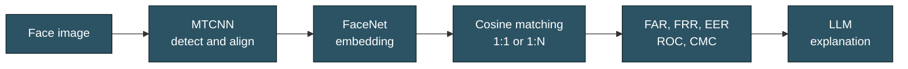

 

📍 France &nbsp;·&nbsp; 🎓 M2 at UPEC, Paris-Est Créteil &nbsp;·&nbsp; 🗣️ English · French

 

## About me

Hi, I'm Noman. I'm a Master's student in **Biometrics and Intelligent Systems** at Université Paris-Est Créteil in France, now in M2 after finishing my first year with honours. Computer vision, machine learning and applied AI are what I enjoy most.

I came to this through Information Technology: I spent two years building software for clients, then co-authored a CNN paper on solar-panel defect detection before moving to Paris for my Master's. I like seeing a project through from start to finish: training a model, checking properly whether it actually works, and then putting it behind an API or a web interface so people can try it.

## Tech stack

**Languages** 

**Computer vision & biometrics** 

**Machine learning & deep learning** 

**Backend & web** 

**Data & tools** 

## Featured projects

### 🔐 [Facial Biometrics System with LLM-Assisted Evaluation](https://github.com/Mr-Noman-Khan/Facial-Biometrics-llm)

A Flask research prototype for face verification (1:1) and identification (1:N), built for local experimentation and demonstration.

- Face quality checks for lighting, blur, resolution, face size and tilt
- Verification metrics: FAR, FRR, EER, ROC and DET curves. Identification metrics: Rank-1, Rank-k and CMC
- Robustness experiments under changes in illumination, blur, resolution and compression
- Web dashboard for enrollment, verification, identification, evaluation and audit logs
- Optional LLM explanations of metrics and decisions, with OpenAI or a local Qwen model
- Experiment tracking with MLflow

<!-- Add a screenshot of the dashboard here, using synthetic or non-sensitive images only -->

`Python` · `Flask` · `FaceNet` · `MTCNN` · `OpenCV` · `MLflow`

### 📄 [SolarAI: Solar-Panel Optimization & Defect Resolution using CNN](https://www.researchgate.net/publication/385549917_SolarAI_Solar-Panel_Optimization_Defect_Resolution_using_CNN)

A published research paper, co-authored during my final bachelor year, on using a convolutional neural network to detect defects in solar panels so they can be found and fixed early.

`CNN` · `Deep Learning` · `Image Classification` · `Python`

### More on my profile

[Personal Portfolio](https://github.com/Mr-Noman-Khan/noman-khan-portfolio) ([live](https://noman-khan.vercel.app/)) · [Nagging Chatbot](https://github.com/Mr-Noman-Khan/Nagging-Chatbot) · [React Labs](https://github.com/Mr-Noman-Khan/React_labs) · [React Budget App](https://github.com/Mr-Noman-Khan/React_budget_app)

## Currently exploring

Deep learning for computer vision, with a focus on face recognition losses and proper model evaluation, and on turning models into practical applications.

## Get in touch

📧 [noman.khan.job@gmail.com](mailto:noman.khan.job@gmail.com) &nbsp;·&nbsp; 💼 [LinkedIn](https://www.linkedin.com/in/noman-khan-b90914289/) &nbsp;·&nbsp; 🌐 [Portfolio](https://noman-khan.vercel.app/)
